# 🌍 TravelEase – Smart Travel & Tourism Booking System
> **An enterprise-grade, concurrency-safe travel and tourism booking web platform built with Django 5, Django REST Framework, and PostgreSQL / SQLite.**

[](https://www.djangoproject.com/)
[](https://www.django-rest-framework.org/)
[](https://www.python.org/)
[](https://www.postgresql.org/)
[](http://localhost:8000/api/docs/)
[-success.svg)](docs/TESTING_REPORT.md)
[](LICENSE)

---

## 📖 Overview | نظرة عامة

**TravelEase** is an enterprise-grade travel and tourism booking web platform developed as a Software Construction capstone. It provides a robust, commercially structured, database-driven service connecting travelers with certified tour operators and centralized system administrators.

Key engineering highlights include:
- **Concurrency-Safe Bookings**: Strict database row-level locking (`select_for_update`) to prevent overbooking on concurrent departure reservations.
- **Dynamic Hotel Availability**: Exact date-range overlap validation algorithms ensuring zero double-bookings.
- **Academic Payment Gateway**: Deterministic, audit-tracked simulated payment ledger.
- **Dual Presentation**: Fully featured server-rendered Bootstrap 5 web interface + RESTful JSON APIs with interactive Swagger/ReDoc.

---

## 📑 Table of Contents

- [Key Features](#-key-features)
- [Role-Based Portals](#-role-based-portals)
- [User Interface Showcase](#-user-interface-showcase)
- [System Architecture & UML](#-system-architecture--uml)
- [Technology Stack](#-technology-stack)
- [Quick Start & Installation](#-quick-start--installation)
- [Demonstration Accounts](#-demonstration-accounts)
- [REST API & Swagger](#-rest-api--swagger)
- [Automated Testing](#-automated-testing)
- [Project Documentation](#-project-documentation)

---

## ✨ Key Features

| Feature | Description |
|---|---|
| **Multi-Step Package Wizard** | Smooth booking flow with real-time price calculation, passenger manifest collection, and instant receipt generation. |
| **Room Inventory Management** | Real-time calculation of available hotel rooms for specific check-in / check-out ranges. |
| **Concurrency Lock Mechanism** | Guaranteed capacity checks using atomic database transactions to eliminate race conditions. |
| **Audit Trails & Security** | Comprehensive administrative audit log capturing all high-risk operations and booking updates. |
| **RESTful API** | Clean endpoints for destinations, packages, hotels, and reservations with OpenAPI 3.0 schema. |

---

## 👥 Role-Based Portals

```
┌────────────────────────────────────────────────────────────────────────┐
│                        TravelEase Architecture                         │
├────────────────────┬────────────────────┬──────────────────────────────┤
│  👤 Customer       │  🏢 Travel Agent   │  🛡️ Platform Administrator    │
├────────────────────┼────────────────────┼──────────────────────────────┤
│ • Explore places   │ • Publish packages │ • Financial KPI analytics    │
│ • Book packages    │ • Track departures │ • System-wide bookings log   │
│ • Reserve rooms    │ • View manifests   │ • User & agent verification  │
│ • Printable ticket │ • Manage bookings  │ • Security audit trail       │
└────────────────────┴────────────────────┴──────────────────────────────┘
```

---

## 🖼️ User Interface Showcase

<div align="center">

### Home Page & Destinations
| Home Page | Destinations Catalog |
|:---:|:---:|
| 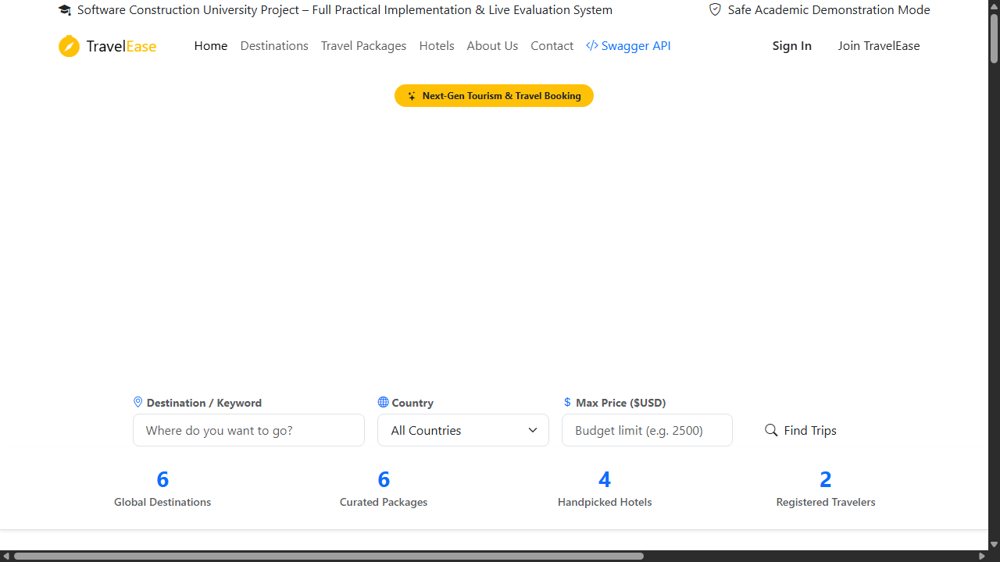 | 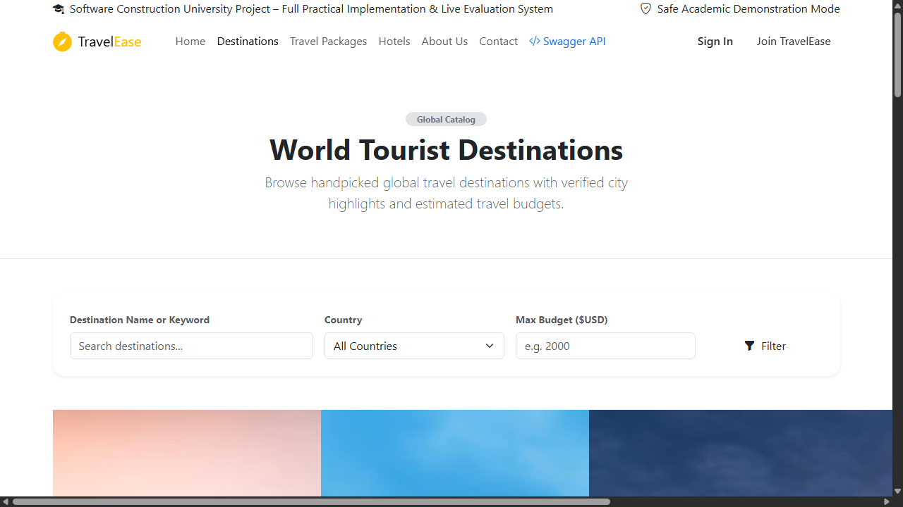 |

### Packages & Booking Experience
| Travel Packages | Booking Confirmation |
|:---:|:---:|
| 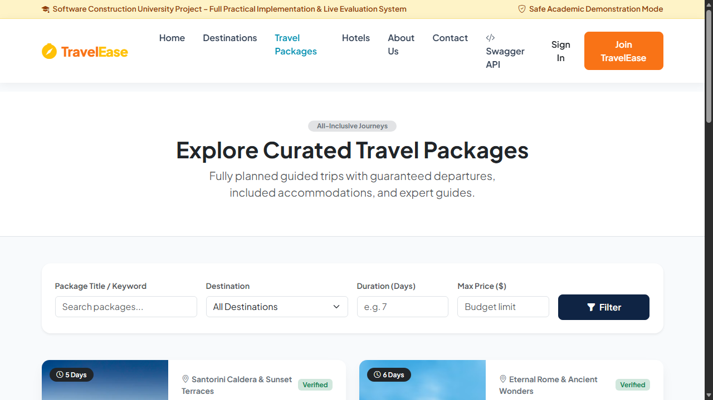 | 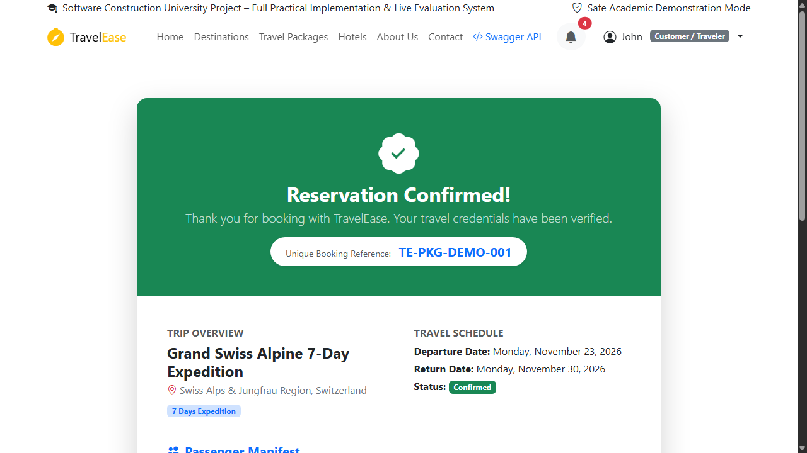 |

### Dedicated Role Dashboards
| Customer Dashboard | Agent Dashboard | Admin Analytics |
|:---:|:---:|:---:|
| 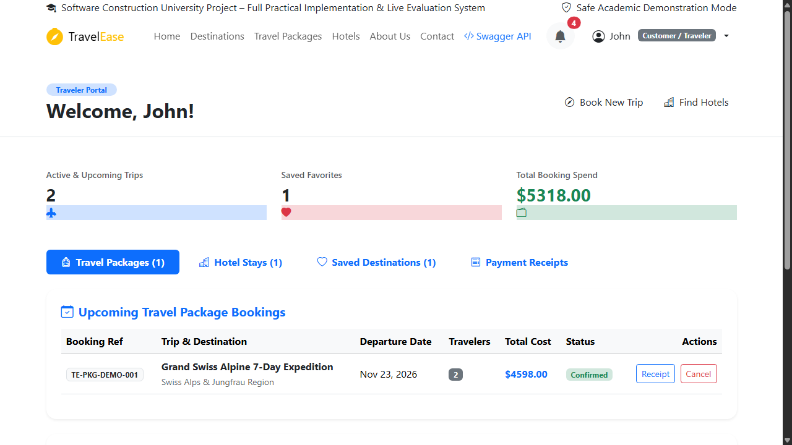 | 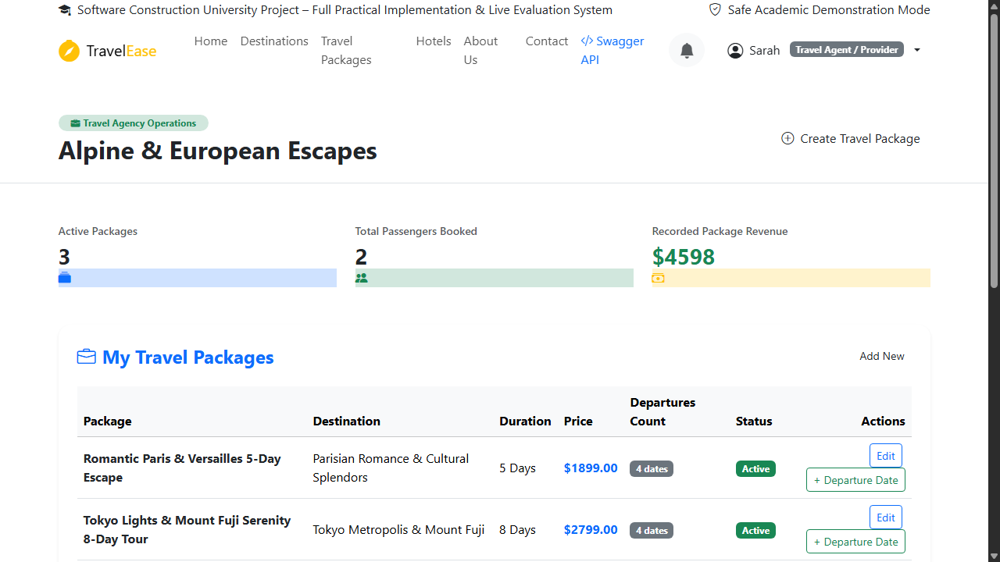 | 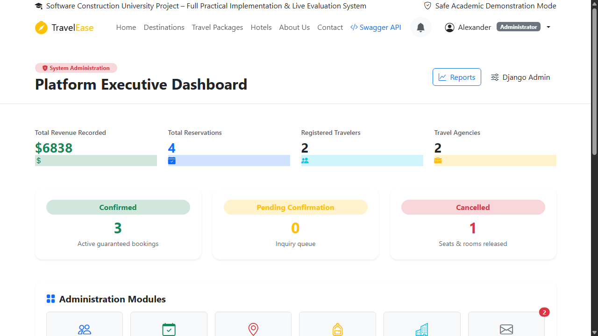 |

</div>

---

## 📐 System Architecture & UML

### High-Level System Architecture

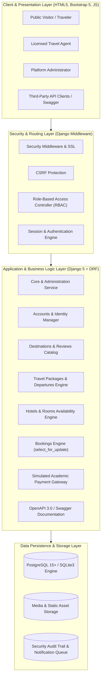

<details>
<summary><b>🔍 Click to view Use Case Diagram</b></summary>

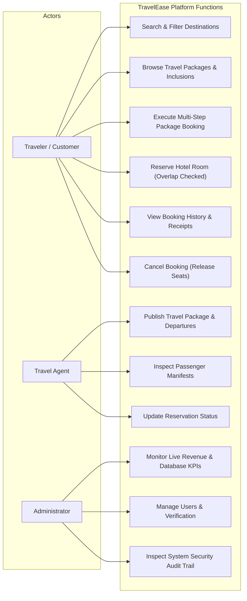
</details>

<details>
<summary><b>🔍 Click to view Class Diagram</b></summary>

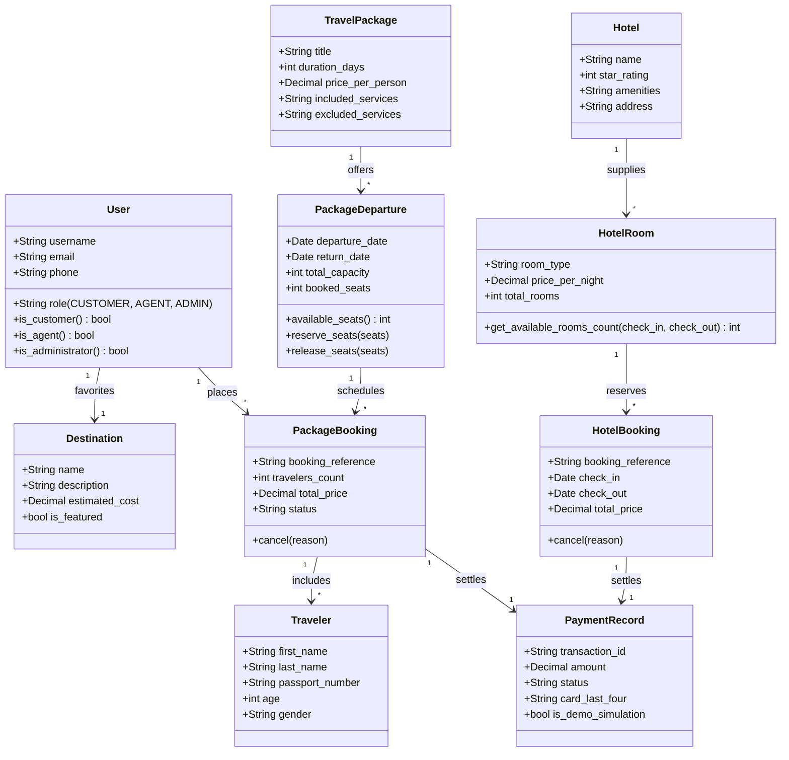
</details>

<details>
<summary><b>🔍 Click to view Sequence Diagram (Concurrency-Safe Booking)</b></summary>

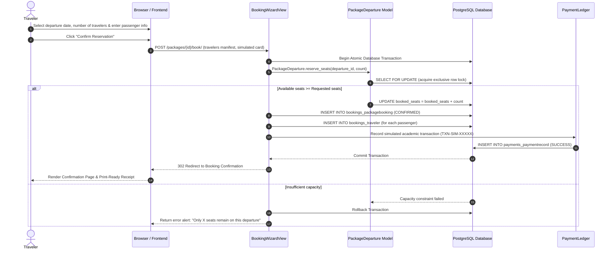
</details>

<details>
<summary><b>🔍 Click to view Activity Diagram (Booking Lifecycle)</b></summary>

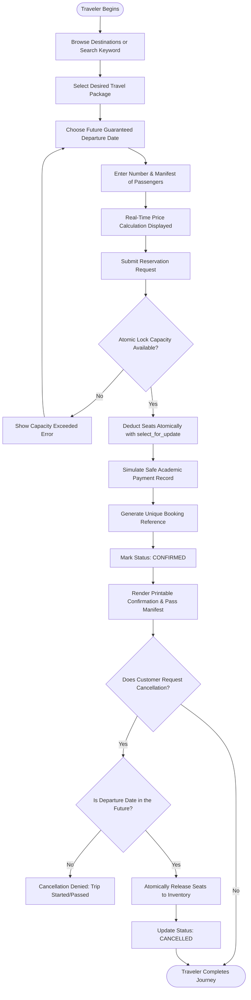
</details>

---

## 🛠️ Technology Stack

- **Backend:** Python 3.10+, Django 5.x, Django REST Framework 3.18
- **Database:** PostgreSQL 15+ (Production / Docker) & SQLite3 (Development)
- **API Documentation:** `drf-spectacular` (OpenAPI 3.0 / Swagger UI / ReDoc)
- **Frontend:** HTML5, CSS3, JavaScript, Bootstrap 5.3, Bootstrap Icons
- **Typography & Brand:** Inter & Plus Jakarta Sans, Deep Navy (`#0f2444`), Turquoise (`#0891b2`), Warm Orange (`#f97316`)
- **DevOps & Containers:** Docker, Docker Compose, Gunicorn, Nginx
- **Testing:** Django Test Suite, `pytest` (19 automated tests, 100% pass)

---

## 🚀 Quick Start & Installation

### Option A: One-Click Script (Windows)
Simply run the included helper batch file:
```cmd
setup_and_run.bat
```
This automatically verifies Python, creates the virtual environment, installs dependencies, runs migrations, and opens the application in your browser.

### Option B: Manual Setup
```bash
# 1. Clone the repository
git clone https://github.com/Alaa-Eriby/TravelEase.git
cd TravelEase

# 2. Create and activate virtual environment
python -m venv venv
# On Windows:
venv\Scripts\activate
# On Linux/macOS:
source venv/bin/activate

# 3. Install dependencies
pip install -r requirements.txt

# 4. Run database migrations
python manage.py migrate

# 5. Populate sample demonstration data
python manage.py seed_data

# 6. Start development server
python manage.py runserver 127.0.0.1:8000
```
Visit **`http://127.0.0.1:8000/`** in your browser.

### Option C: Docker Deployment
```bash
docker-compose up --build
```

---

## 🔑 Demonstration Accounts

The platform includes pre-configured demo accounts loaded via `python manage.py seed_data`:

| Role | Username | Password | Access Scope |
|---|---|---|---|
| 🛡️ **Administrator** | `admin` | `AdminPass123!` | Full control, financial KPIs, user roles & audit logs |
| 🏢 **Travel Agent** | `agent_sarah` | `AgentPass123!` | Package management, manifests & reservation updates |
| 👤 **Traveler / Customer** | `traveler_john` | `TravelerPass123!` | Destination browsing, booking wizard & receipts |

---

## 📡 REST API & Swagger

TravelEase exposes full REST APIs with interactive documentation:

- **Swagger UI:** [`http://127.0.0.1:8000/api/docs/`](http://127.0.0.1:8000/api/docs/)
- **ReDoc:** [`http://127.0.0.1:8000/api/redoc/`](http://127.0.0.1:8000/api/redoc/)
- **OpenAPI Schema:** Generated via `schema.yml`

---

## 🧪 Automated Testing

Run the full automated test suite covering authentication, concurrency locks, booking wizards, and API endpoints:
```bash
python manage.py test
```
```
Found 19 test(s).
System check identified no issues (0 silenced).
...................
----------------------------------------------------------------------
Ran 19 tests in 69.412s

OK (19 passed, 0 failed)
```

---

## 📚 Project Documentation

Detailed technical documentation is available in the [`docs/`](docs/) directory:

- 📘 **[Installation Guide](INSTALLATION.md)** — Comprehensive setup instructions
- 🗄️ **[Database Documentation & ERD](docs/DATABASE_DOCUMENTATION.md)** — Relational schemas and data dictionary
- 🔌 **[API Documentation](docs/API_DOCUMENTATION.md)** — Endpoint definitions and payload samples
- 🧪 **[Testing & QA Report](docs/TESTING_REPORT.md)** — Test cases and verification evidence
- 📖 **[User Guide](docs/USER_GUIDE.md)** — Step-by-step role walkthroughs
- 🐳 **[Deployment & Docker Guide](docs/DEPLOYMENT_GUIDE.md)** — Production deployment workflows

---

<div align="center">
  <sub>TravelEase • Software Construction Course Capstone • Developed with ❤️ by Alaa Eriby </sub>
</div>
