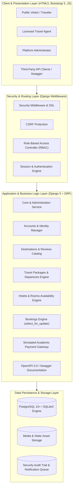
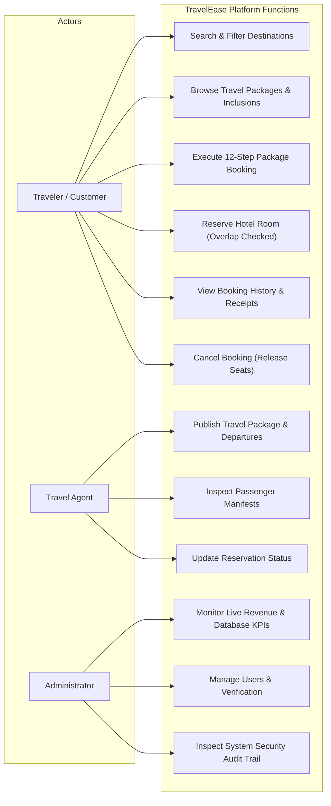
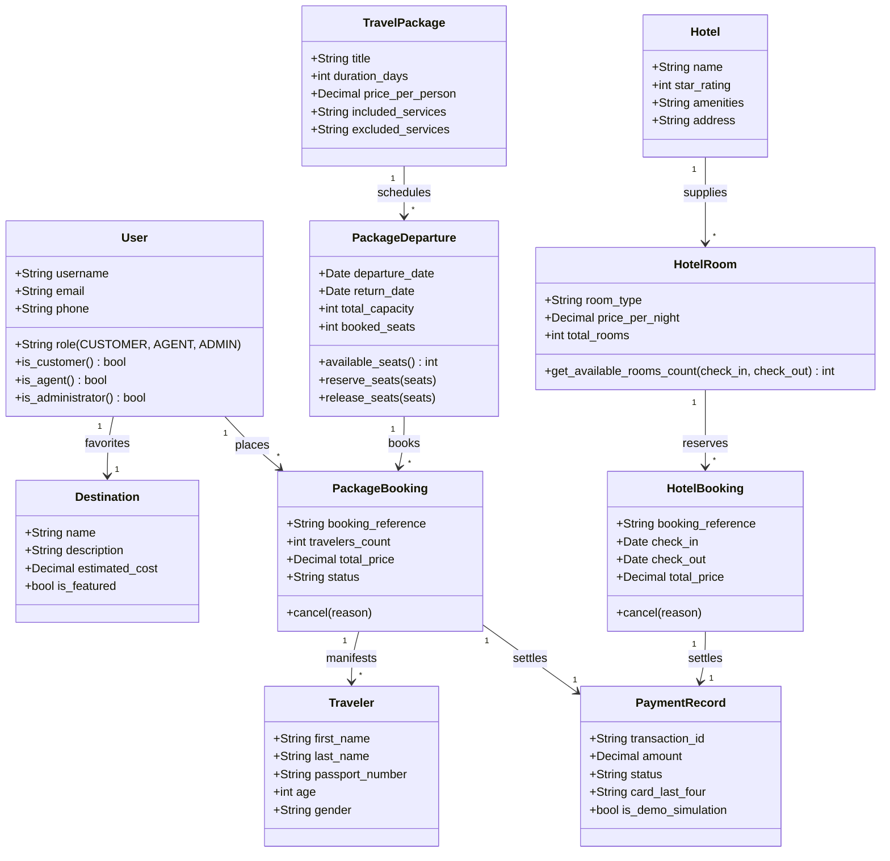
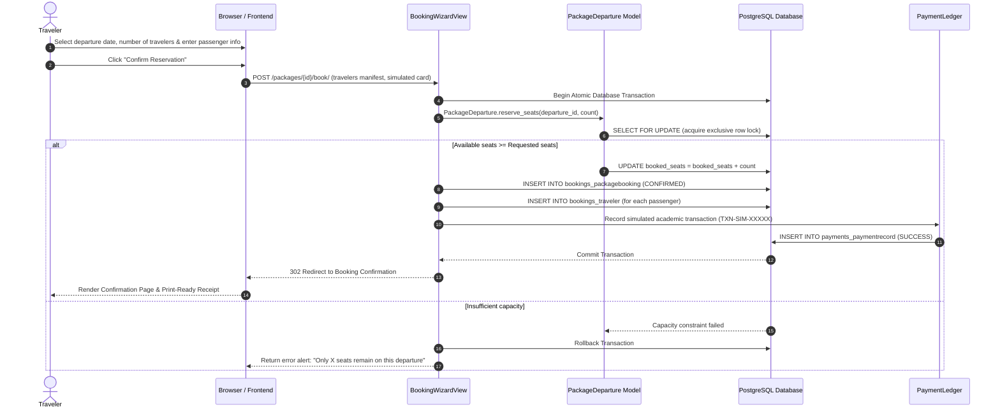

# TravelEase – Smart Travel and Tourism Booking System
## Software Construction Course – Complete Practical Implementation Capstone

[](https://www.djangoproject.com/)
[](https://www.django-rest-framework.org/)
[](https://www.postgresql.org/)
[](http://localhost:8000/api/docs/)
[-success.svg)](docs/TESTING_REPORT.md)

---

### 1. Project Concept & Executive Summary

**TravelEase** is an enterprise-grade travel and tourism booking web application developed for the university Software Construction course. It delivers a genuinely functional, database-connected commercial platform that connects travelers with licensed tourism service providers and central administrators.

The system features real concurrency-safe capacity locks, dynamic room inventory tracking, an academic safe payment ledger, and dedicated role portals for **Customers**, **Travel Agents**, and **Platform Administrators**.

---

### 2. High-Level System Architecture Diagram



---

### 3. Use Case Diagram



---

### 4. Class Diagram



---

### 5. Sequence Diagram: Concurrency-Safe Travel Package Booking



---

### 6. Activity Diagram: Travel Booking Lifecycle


---

### 7. Technology Stack
- **Backend Framework:** Python 3.10+, Django 5.x, Django REST Framework 3.18.
- **API Documentation:** `drf-spectacular` (OpenAPI 3.0 / Swagger UI / ReDoc).
- **Frontend Stack:** HTML5, CSS3, Bootstrap 5.3, Bootstrap Icons, Custom Visual Identity (Inter & Plus Jakarta Sans typography, deep navy `#0f2444`, turquoise `#0891b2`, warm orange `#f97316`).
- **Database:** PostgreSQL 15+ (Production / Docker) & SQLite3 (instant zero-configuration local runs).
- **Deployment:** Docker & Docker Compose (`docker-compose.yml`), Gunicorn, Nginx.
- **Testing:** Django Test Suite & `pytest` (19 automated unit & integration test cases with 100% pass rate).

---

### 8. Installation & Quick Start

```powershell
# 1. Activate virtual environment
.\venv\Scripts\activate

# 2. Run database migrations
python manage.py migrate

# 3. Seed demonstration database
python manage.py seed_data

# 4. Start local development server
python manage.py runserver 127.0.0.1:8000
```
Open **`http://localhost:8000/`** in your browser.

---

### 9. Demonstration Credentials
- **Administrator:** `admin` / `AdminPass123!`
- **Travel Agent:** `agent_sarah` / `AgentPass123!`
- **Traveler:** `traveler_john` / `TravelerPass123!`

---

### 10. Automated Test Results
Run the test suite with:
```powershell
python manage.py test
```
**Results:** `Ran 19 tests in 69s. OK (19 passed, 0 failed)`.

---

### 11. Documentation Pointers
- **[Installation Guide](INSTALLATION.md)**
- **[Database Documentation & ERD](docs/DATABASE_DOCUMENTATION.md)**
- **[API Documentation & Swagger](docs/API_DOCUMENTATION.md)**
- **[Testing & QA Report](docs/TESTING_REPORT.md)**
- **[User Guide & Demonstration Steps](docs/USER_GUIDE.md)**
- **[Deployment & Docker Guide](docs/DEPLOYMENT_GUIDE.md)**
# TravelEase

