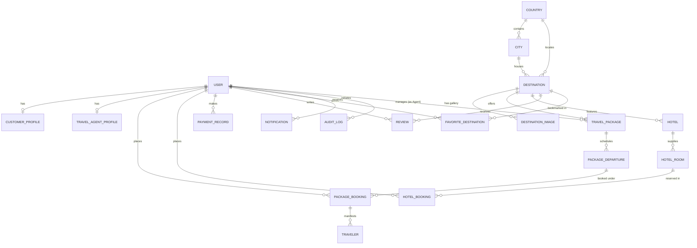

# TravelEase – Database Architecture & Data Dictionary
## Software Construction Course – Comprehensive Database Specification

### 1. Database Overview & Technology Stack
- **Database Engine:** PostgreSQL 15+ (Production / Docker) & SQLite 3 (Zero-setup local development fallback).
- **ORM:** Django 5.x ORM with strict referential integrity, foreign key cascades/protects, unique constraints, and atomic transactions.
- **Concurrency Management:** Row-level locks (`select_for_update()`) on `PackageDeparture` and overlap date-window queries on `HotelBooking` to prevent overbooking and double-booking under concurrent load.

---

### 2. Entity Relationship Diagram (ERD)

---

### 3. Data Dictionary & Table Definitions

#### A. Accounts & Identities
1. **`accounts_user`**
   - `id`: BigAutoField, Primary Key.
   - `username`: CharField(150), Unique, Indexed.
   - `email`: EmailField, Indexed.
   - `password`: CharField(128), PBKDF2/SHA256 hashed.
   - `role`: CharField(20), Enum (`CUSTOMER`, `AGENT`, `ADMIN`), Default: `CUSTOMER`.
   - `phone`: CharField(30), Nullable.
   - `avatar`: ImageField, Path to profile image.
   - `date_joined`: DateTimeField.

2. **`accounts_customerprofile`**
   - `id`: BigAutoField, Primary Key.
   - `user_id`: OneToOneField -> `accounts_user`, Cascade delete.
   - `passport_number`: CharField(50).
   - `nationality`: CharField(100).
   - `date_of_birth`: DateField, Nullable.
   - `address`: CharField(255).
   - `emergency_contact`: CharField(100).
   - `emergency_phone`: CharField(30).

3. **`accounts_travelagentprofile`**
   - `id`: BigAutoField, Primary Key.
   - `user_id`: OneToOneField -> `accounts_user`, Cascade delete.
   - `agency_name`: CharField(150).
   - `license_number`: CharField(100), Unique.
   - `business_email`: EmailField.
   - `bio`: TextField.
   - `is_verified`: BooleanField, Default: True.
   - `rating`: DecimalField(3, 2), Default: 5.00.

#### B. Destinations Catalog
4. **`destinations_country`**
   - `id`: BigAutoField, Primary Key.
   - `name`: CharField(100), Unique.
   - `code`: CharField(5), Unique (ISO Alpha-3).
   - `description`: TextField.

5. **`destinations_city`**
   - `id`: BigAutoField, Primary Key.
   - `name`: CharField(100).
   - `country_id`: ForeignKey -> `destinations_country`.
   - *Constraint:* `unique_together = ('name', 'country')`.

6. **`destinations_destination`**
   - `id`: BigAutoField, Primary Key.
   - `name`: CharField(150).
   - `city_id`: ForeignKey -> `destinations_city`.
   - `country_id`: ForeignKey -> `destinations_country`.
   - `description`: TextField.
   - `popular_attractions`: TextField.
   - `estimated_cost`: DecimalField(10, 2).
   - `image`: ImageField.
   - `image_url`: URLField(500).
   - `is_featured`: BooleanField, Indexed.

7. **`destinations_destinationimage`**
   - `id`: BigAutoField, Primary Key.
   - `destination_id`: ForeignKey -> `destinations_destination`.
   - `image_url`: URLField(500).
   - `caption`: CharField(200).

8. **`destinations_review`**
   - `id`: BigAutoField, Primary Key.
   - `user_id`: ForeignKey -> `accounts_user`.
   - `destination_id`: ForeignKey -> `destinations_destination` (Nullable).
   - `travel_package_id`: ForeignKey -> `packages_travelpackage` (Nullable).
   - `hotel_id`: ForeignKey -> `hotels_hotel` (Nullable).
   - `rating`: IntegerField (1 to 5).
   - `comment`: TextField.
   - `is_approved`: BooleanField, Default: True.

#### C. Travel Packages & Departures
9. **`packages_travelpackage`**
   - `id`: BigAutoField, Primary Key.
   - `title`: CharField(200).
   - `agent_id`: ForeignKey -> `accounts_user`.
   - `destination_id`: ForeignKey -> `destinations_destination`.
   - `duration_days`: PositiveIntegerField.
   - `price_per_person`: DecimalField(10, 2).
   - `description`: TextField.
   - `included_services`: TextField.
   - `excluded_services`: TextField.
   - `image_url`: URLField(500).
   - `is_featured`: BooleanField.
   - `is_active`: BooleanField.

10. **`packages_packagedeparture`**
    - `id`: BigAutoField, Primary Key.
    - `package_id`: ForeignKey -> `packages_travelpackage`.
    - `departure_date`: DateField, Indexed.
    - `return_date`: DateField.
    - `total_capacity`: PositiveIntegerField, Default: 20.
    - `booked_seats`: PositiveIntegerField, Default: 0.
    - `price_override`: DecimalField(10, 2), Nullable.
    - `is_active`: BooleanField.
    - *Constraint:* `unique_together = ('package', 'departure_date')`.

#### D. Hotels & Rooms
11. **`hotels_hotel`**
    - `id`: BigAutoField, Primary Key.
    - `name`: CharField(200).
    - `destination_id`: ForeignKey -> `destinations_destination`.
    - `address`: CharField(255).
    - `star_rating`: IntegerField (1 to 5).
    - `description`: TextField.
    - `amenities`: TextField.
    - `phone`: CharField(30).
    - `email`: EmailField.
    - `image_url`: URLField(500).
    - `is_featured`: BooleanField.

12. **`hotels_hotelroom`**
    - `id`: BigAutoField, Primary Key.
    - `hotel_id`: ForeignKey -> `hotels_hotel`.
    - `room_type`: CharField(20) (`SINGLE`, `DOUBLE`, `DELUXE`, `FAMILY`, `PRESIDENTIAL`).
    - `name`: CharField(150).
    - `capacity`: PositiveIntegerField.
    - `price_per_night`: DecimalField(10, 2).
    - `total_rooms`: PositiveIntegerField.
    - `image_url`: URLField(500).
    - `is_active`: BooleanField.

#### E. Bookings, Manifests & Simulated Payments
13. **`bookings_packagebooking`**
    - `id`: BigAutoField, Primary Key.
    - `booking_reference`: CharField(30), Unique, Indexed (e.g. `TE-PKG-XXXXXXXX`).
    - `customer_id`: ForeignKey -> `accounts_user`.
    - `departure_id`: ForeignKey -> `packages_packagedeparture`, OnDelete: Protect.
    - `travelers_count`: PositiveIntegerField.
    - `unit_price`: DecimalField(10, 2).
    - `total_price`: DecimalField(10, 2).
    - `status`: CharField(20) (`PENDING`, `CONFIRMED`, `CANCELLED`, `COMPLETED`).
    - `special_requests`: TextField.
    - `cancellation_reason`: TextField.
    - `cancelled_at`: DateTimeField, Nullable.

14. **`bookings_traveler`**
    - `id`: BigAutoField, Primary Key.
    - `booking_id`: ForeignKey -> `bookings_packagebooking`, Cascade.
    - `first_name`: CharField(100).
    - `last_name`: CharField(100).
    - `passport_number`: CharField(50).
    - `age`: PositiveIntegerField.
    - `gender`: CharField(20) (`M`, `F`, `O`).

15. **`bookings_hotelbooking`**
    - `id`: BigAutoField, Primary Key.
    - `booking_reference`: CharField(30), Unique, Indexed (e.g. `TE-HTL-XXXXXXXX`).
    - `customer_id`: ForeignKey -> `accounts_user`.
    - `room_id`: ForeignKey -> `hotels_hotelroom`, OnDelete: Protect.
    - `check_in`: DateField.
    - `check_out`: DateField.
    - `guests_count`: PositiveIntegerField.
    - `rooms_count`: PositiveIntegerField.
    - `price_per_night`: DecimalField(10, 2).
    - `total_price`: DecimalField(10, 2).
    - `status`: CharField(20).

16. **`payments_paymentrecord`**
    - `id`: BigAutoField, Primary Key.
    - `transaction_id`: CharField(40), Unique, Indexed.
    - `user_id`: ForeignKey -> `accounts_user`.
    - `booking_type`: CharField(20) (`PACKAGE`, `HOTEL`).
    - `booking_reference`: CharField(50), Indexed.
    - `amount`: DecimalField(10, 2).
    - `currency`: CharField(10), Default: 'USD'.
    - `payment_method`: CharField(30).
    - `status`: CharField(20) (`SUCCESS`, `PENDING`, `FAILED`, `REFUNDED`).
    - `card_last_four`: CharField(4), Default: '4242'.
    - `is_demo_simulation`: BooleanField, Default: True.

17. **`core_contactmessage`**
    - `id`: BigAutoField, Primary Key.
    - `name`: CharField(150).
    - `email`: EmailField.
    - `subject`: CharField(255).
    - `message`: TextField.
    - `is_read`: BooleanField.

18. **`core_auditlog`**
    - `id`: BigAutoField, Primary Key.
    - `user_id`: ForeignKey -> `accounts_user`, Nullable.
    - `action`: CharField(100).
    - `target_model`: CharField(100).
    - `target_id`: CharField(100).
    - `details`: TextField.
    - `created_at`: DateTimeField.
